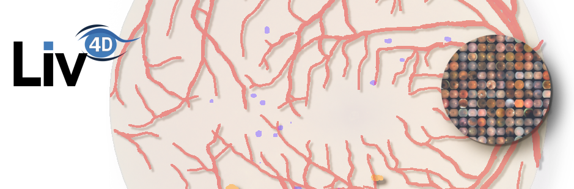

# The Fundus ODMAC Toolkit

This project aims to evaluate the performance of different models for the segmentation of optic disk and macula in fundus images. The reported perfomance metrics are not always consistent in the literature. Our goal is to provide a fair comparison between different models using the same datasets and evaluation protocol.


## Installation

```bash
pip install .
```

or
```bash
pip install -e .
```

## Usage

To use these models, please consult the [example notebook](notebooks/test_models.ipynb). You don't have to download the models. We rely on HuggingFace for that.
```python

from fundus_data_toolkit.functional import open_image
from fundus_odmac_toolkit.models.segmentation import segment

filepath = 'my_folder/my_image.(jpeg/png/...)'
image = open_image(filepath)
pred = segment(image) 
# You don't need to resize, crop or normalize 
# the image as it will be done automatically.
# On the first call of the function, the model's weight will be automatically downloaded.
# You can change the architecture/encoder by calling:
pred = segment(image, arch='unetplusplus', encoder='seresnet50')
# Call fundus_odmac_toolkit.models.list_models() for a list of all available models.
# The retrained "v2" weights are loaded by default. For the original 2024 weights:
pred = segment(image, revision='main')

# pred is a post-softmax output of size 3xHxW. 
# First channel: Background score
# Second channel: Optic Disk score
# Last channel: Macula score.

```

# Benchmark
In short, we recommend the UNet with the maxvit_small_tf_512 encoder (set as the default).

<!-- BENCHMARK:START (generated by benchmarks/update_readme.py, do not edit by hand) -->
Weights `v2` (default). All models are evaluated without test-time augmentation by [`benchmarks/run_benchmarks.py`](benchmarks/run_benchmarks.py); raw results are in [`benchmarks/results.jsonl`](benchmarks/results.jsonl).

| Architecture | Encoder | IDRiD OD IoU | RIGA-Magrabia OD IoU | RIGA-MESSIDOR OD IoU | IDRiD OD distance (px) | IDRiD fovea distance (px) |
|:---:|:---:|:---:|:---:|:---:|:---:|:---:|
| UNet | seresnet50 | 92.59% | 89.07% | 89.94% | 28.40 | **45.90** (16 undetected) |
| UNet | mobilevitv2_100 | 92.24% | 88.58% | 89.85% | 25.78 | 76.38 (9 undetected) |
| UNet | mobilenetv3_small_050 | 91.95% | 87.11% | 87.84% | 29.76 | 64.09 (24 undetected) |
| UNet | maxvit_tiny_tf_512 | 92.10% | 88.63% | 91.08% | 28.06 | 48.06 (9 undetected) |
| UNet | maxvit_small_tf_512 | **92.98%** | 89.20% | 90.88% | **22.84** | 47.72 (8 undetected) |
| UNet | maxvit_base_tf_512 | 91.95% | 90.21% | **92.09%** | 28.09 | 51.29 (6 undetected) |
| UNet++ | seresnet50 | 91.37% | **90.27%** | 91.35% | 27.55 | 85.53 (12 undetected) |
| UNet++ | mobilenetv3_small_050 | 90.37% | 88.45% | 87.16% | 28.57 | 90.63 (15 undetected) |

- **OD IoU**: Jaccard index of the optic disc, accumulated over all pixels of the test set.
  IDRiD: segmentation challenge test set (27 images).
  RIGA: majority vote of the 6 annotators (Magrabia: 95 images, MESSIDOR: 460 images).
- **Distance**: mean Euclidean distance (pixels) between the centroid of the predicted structure and the ground-truth center,
  on the IDRiD localization challenge test set (103 images), averaged over the images where the structure is detected;
  the number of images where it is not detected is given in parentheses. (`results.jsonl` also gives the mean over all images,
  using the most probable pixel when nothing is detected: it is dominated by these few failures.)
- Best result per column in bold. See the [official IDRiD leaderboard](https://idrid.grand-challenge.org/Leaderboard/) for comparison.
- *We did not use the IDRiD segmentation masks for training.*
<!-- BENCHMARK:END -->

# Training
The `v2` weights were trained with [`scripts/train.py`](scripts/train.py) and [`config/config.yaml`](config/config.yaml) on 290 fundus images
from EyePACS, DDR, APTOS and IDRiD with manually annotated optic disc and macula masks
(80/20 train/test split per dataset, 20% of the training images held out for validation).
Images are cropped to the fundus, resized to 512×512 and augmented with flips, affine transforms and colour jitter.
Loss: Dice + cross-entropy. Optimizer: AdamW (decoder 3e-4, pretrained encoder 3e-5, weight decay 0.01),
linear warm-up then cosine decay, batch size 8, 300 epochs, best epoch selected on the validation IoU.
